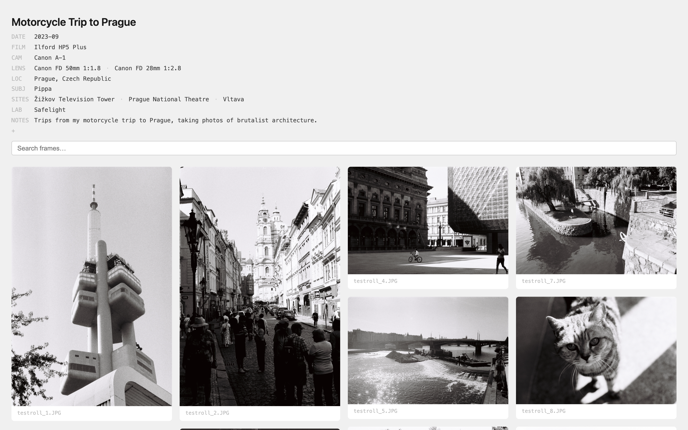

# contact


contact keeps an archive of analog film scans. A vision model running on your own computer describes and tags every frame. You add what it can't know (who, which building, where), and everything is written next to the scans: XMP sidecars that Lightroom, darktable and Finder read, and an HTML contact sheet per roll ([see one](https://moltaire.github.io/contact)).

- **A library of all your rolls.** Browse them as little contact sheets, or search every frame at once by what is in it, who, where, film or date.
- **A frame view built for the keyboard.** Step through frames, correct descriptions, add people, landmarks and places, or tell the model a fact and let it rewrite the frame.
- **Local and plain.** Ollama runs the model, nothing leaves your machine, and all metadata lives in ordinary files next to the scans.

---

## Requirements

- Python 3.10+
- [Ollama](https://ollama.com) with a vision model

```bash
brew install ollama        # or download it from ollama.com
ollama pull gemma4:e4b     # about 10 GB; runs comfortably in 16 GB of RAM
```

contact starts Ollama itself when it isn't running.

## Install

```bash
uv tool install .
```

This installs `contact-ui` (the app) and `contact` (the command line).

---

## The app

```bash
contact-ui
```

It runs locally and opens in your browser. The browser's back and forward buttons work everywhere, `?` lists every shortcut, and the gear opens Settings.

### Adding a new roll

1. **New roll** (top right) opens a folder of fresh scans.
2. The roll page opens with its form: label, film, camera, lenses, date, location (`City, Country`), the people and landmarks on the roll, lab and notes. Earlier entries are suggested as you type.
3. **Tag N new frames.** Tagging runs in the background; frames fill in as they finish, and you can switch pages or close the browser meanwhile.
4. **Edit frames** to go through the results (see below).
5. **Rename to …** gives the folder the standard `date_label` name, and **Move into library** moves it in with your other rolls. The contact sheet (`index.html`) is already in the folder.

### Browsing and touching up


The **library** is the home page. Point it once at the folder that holds all your roll folders. Each roll shows as a small contact sheet of its first frames (favourites first), grouped by year. Click a roll to see its frames, or its arrow to open the roll's page.


**Search** looks through descriptions, tags, people, landmarks and places, and each roll's film, camera, lens and date. It ignores case and accents; quotes keep words together, and a prefix limits a word to one field: `person:ines`, `place:athens`, `film:hp5`, `tag:tower`, `date:2024`, `is:starred`. **Filters** lists the people, places and film stocks in the library. The switch, or `V`, shows the results as **Rolls** or as **Frames**.

### A roll


A roll's page shows its facts, your notes, the generated summary (click **summary** to fold it away) and every frame.

- **Edit info** turns the facts into the form, right there.
- **Re-tag frames…** lets you pick frames to run through the model again: click them (Shift-click for a range), then **Re-tag N frames**.
- **Contact sheet** opens the roll's `index.html`.
- Esc steps back out: picking, the form, then the library.

### A frame


Click any frame to see it large, over the library or the roll. ← → step through the frames you were looking at, across rolls when they come from a search. Esc goes back to where you were.

- `S` marks a favourite. Favourites are shared with the contact sheet.
- `[` `]` turn a sideways scan. Only the file's orientation flag changes, so the image data stays untouched and the rotation shows in Finder, Lightroom and the contact sheet too.
- `R` opens the frame's roll.
- `E` switches between **View** and **Edit**, and the app remembers which you used last.

**Edit** adds the roll's filmstrip and one entry line under the description. Everything is saved as you go.

- **The entry line has five modes:** fact, tags, people, landmarks and place (`F`, `T`, `P`, `L`, `W` open it in that mode). Return opens it, Tab switches the mode while it's empty, Return applies and leaves it.
- **A fact** is something the model can't know ("this is the Parthenon in Athens"). The model rewrites the description, tags and category with it, and you can undo. Facts stay with the frame and are used again when it's re-tagged.
- **Names** go in several at a time, separated by commas, and Tab completes a known one. The roll's people, landmarks and places appear under the line to click, and `1`–`9` toggle the roll's people.
- **Removing:** click an entry in the sheet, or press Backspace on an empty line.
- **Several frames at once:** ⌘/Ctrl-click or Shift-click in the filmstrip, or Shift-← →, or `A` for all. Whatever you enter then applies to all of them.

When you close the frame view, the contact sheets and summaries of the rolls you changed catch up.

<p>
  
  
</p>

**Settings** (the gear) chooses the vision and text model and tidies the remembered options: places, people, landmarks, lenses, cameras, film stocks and labs. It also quits the app.

Other options: `contact-ui --folder DIR` opens a roll straight away, `--library DIR` shows another folder of rolls for one run, and `--light` uses the light theme.

---

## Command line

The same tagging without the app, for one roll or many:

```bash
contact --init ~/scans/tuscany/       # describe the roll in the terminal, then tag it
contact ~/scans/tuscany/              # tag what isn't tagged yet
contact ~/scans/2024/                 # a parent folder: every roll in it
```

| Flag | Description |
|---|---|
| `--init` | Describe the roll interactively first |
| `--model MODEL` | Vision model (default: the best installed one, e.g. `gemma4:e4b`) |
| `--text-model MODEL` | Model for the roll summary (default: the vision model) |
| `--force` | Re-tag frames that already have a sidecar |
| `--dry-run` | Show what would be written, write nothing |
| `--verbose` | Print the model's full answer per frame |
| `--no-rename-folder` | Keep the folder's name |

---

## What's written to disk

Everything sits next to the scans, so the folder is the archive:

- **`roll.yaml`**: the roll's facts and, after tagging, its summary.
- **One XMP sidecar per frame**: description, tags, category, people, landmarks, place, favourite (as a 5-star rating) and the facts you gave the model, plus the roll's film, camera and lens. Lightroom, darktable, Finder and Spotlight can read them.
- **`index.html`**: a self-contained contact sheet with the roll's details, a lightbox, search (`/` or Return) and favourites.

Your remembered options are kept in `~/.config/contact/history.json`, and the app's settings in `settings.json` next to it.

## How tagging works

Each frame goes to the vision model once. It answers with a two- or three-sentence description of what is visible, a few generic lowercase tags and one category. It is told not to guess who or where: names, landmarks and places are yours to add. When you state a fact, it goes back to the model to rewrite that frame. Tags are cleaned in code after every answer: lowercased, without duplicates, and never a person, landmark or place, since those have their own fields. After a roll is tagged, a text model writes the short summary of the whole roll.

## Try it

A tagged sample roll is in `docs/example/sample-roll/`, with its sidecars and contact sheet ([live version](https://moltaire.github.io/contact)). Open it in the app as a one-roll library; browsing and editing by hand works without Ollama:

```bash
contact-ui --library docs/example/
```

## Limitations

The model runs on your own computer, which keeps your photos private and costs nothing, but a small model does get things wrong now and then. That is what the frame view is for. With plenty of memory you can choose a bigger vision model, or a separate text model for the summaries, in Settings.
