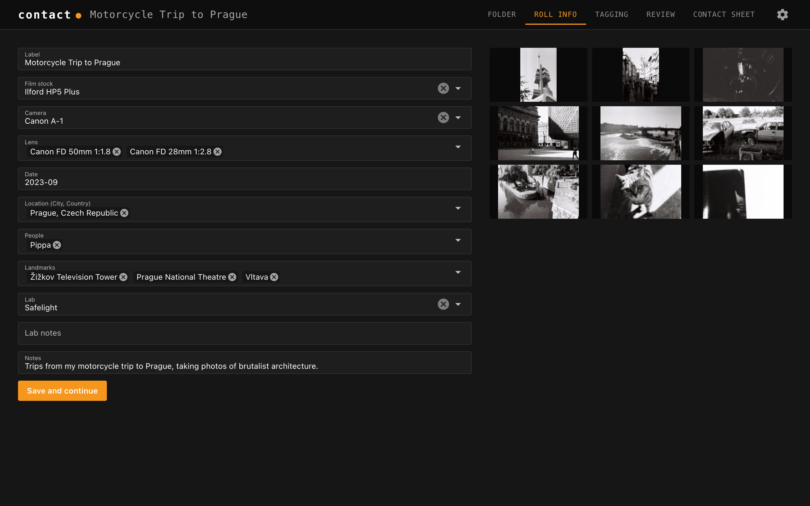
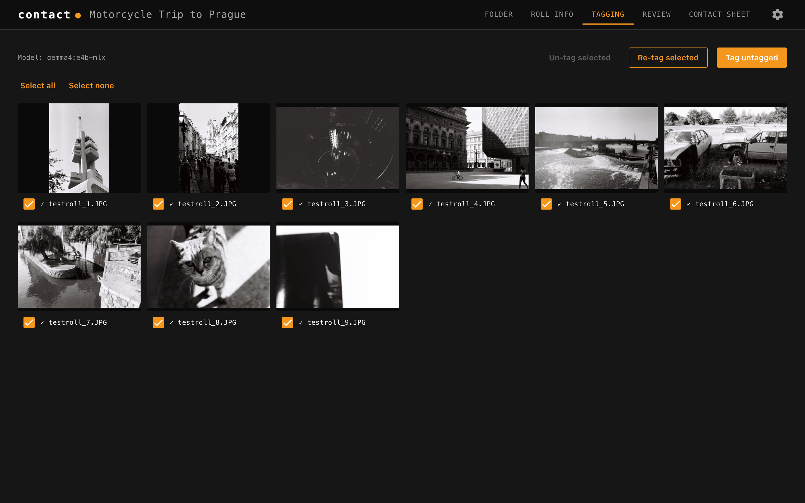
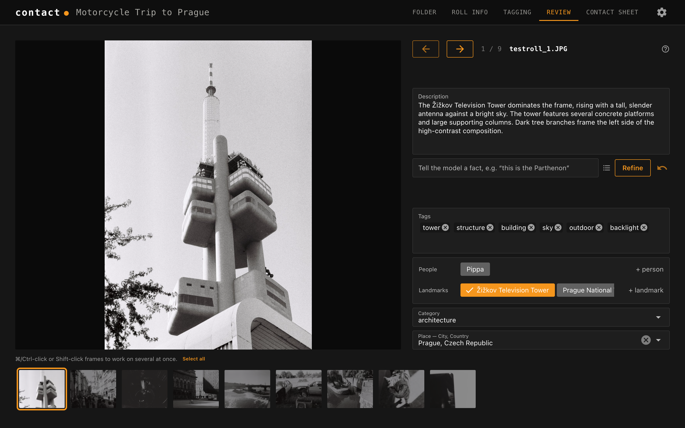
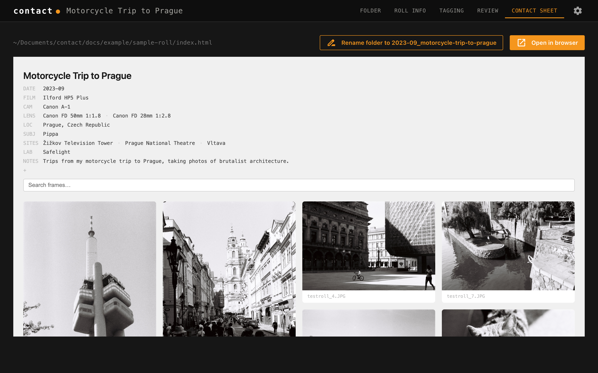

# 🎞️ contact


contact is a tool to tag and archive analog film scans using locally running AI. Set up a roll, point it at a folder of scans, and it generates descriptions, tags, and categories for each frame, writing XMP sidecar files and creating a [browsable HTML contact sheet](https://moltaire.github.io/contact).

---

## Requirements

- Python 3.10+
- [Ollama](https://ollama.com) with a vision model pulled

```bash
brew install ollama        # or download it from ollama.com
ollama pull gemma4:e4b     # about 10 GB; runs comfortably in 16 GB of RAM
```

contact starts Ollama itself when it is not running.

---

## Install

```bash
uv tool install .
```

This installs two commands: `contact` (CLI) and `contact-ui` (browser app; `contact-gui` is the same thing).

---

## App

```bash
contact-ui
# or with a folder pre-loaded:
contact-ui --folder ~/scans/tuscany/
```

The app runs locally and opens in your browser. The browser's back and forward buttons work throughout.

**Library** — the home screen. Point it once at the folder that holds all your roll folders. Every roll appears as a small contact sheet of its first frames (favourites first), grouped by year. A switch (or `V`) changes between **Rolls** and **Frames**, and both follow the search box: it looks through descriptions, tags, people, landmarks, places, and each roll's film, camera, lens and date. Search ignores case and accents, quotes keep words together, and a prefix limits a word to one field (`person:ines`, `place:athens`, `film:hp5`, `tag:tower`, `date:2024`, `is:starred`). **Filters** offers the people, places and film stocks found in the library. The library only reads your folders; the contact sheets stay the thing you browse and share.

**A frame** — click one to see it large, over the library or a roll's page. ← → step through the frames shown (search results run across rolls), `S` marks a favourite, `[` `]` rotate, `R` opens its roll, Esc goes back to where you were. `E` switches between **View** and **Edit**; Edit adds the filmstrip and the editing tools below, and the app remembers which one you used last. Click a roll card to see just that roll's frames; the arrow on the card opens the roll itself.

**A roll** opens from the library, or with **New roll** for a folder of new scans, on one page under a breadcrumb back to the library. It shows the roll at a glance (film, camera, lenses, lab, location, people, landmarks), your notes, the generated summary (click **summary** to fold it away; the app remembers) and every frame in a grid.

- **Edit info** turns the roll's facts into a form right there, with the frames still in view; Save or Esc closes it. A new roll opens with the form.
- **Tag N new frames** starts tagging: it runs in the background, frames fill in as they finish, and you can switch tabs, reload or close the browser meanwhile.
- **Re-tag frames…** lets you click the frames to re-tag (Shift-click picks a range), then **Re-tag N frames**; Esc cancels. Clicking an untagged frame, or ⌘/Ctrl-clicking any frame, starts picking too.
- Also here: open the contact sheet, rename the folder to the standard `date_label` pattern, and move a roll that lives elsewhere into the library.
- Esc steps out one level at a time: picking, the form, then back to the library.

**Editing a frame** is built for the keyboard. **Edit frames** on the roll page opens the first frame in Edit; Return in View does too. Edits are saved automatically. Below the description there is one entry line and a sheet listing the people, landmarks, place, tags and category. When you close the frame, the contact sheets and summaries of the rolls you changed catch up.
   - **The entry line has five modes:** fact, tags, people, landmarks, place. Return opens it, Tab switches mode while it is empty, Return applies and leaves it. `T`, `P`, `L`, `W`, `F` open it straight in a mode, and it remembers the last one.
   - **Fact:** tell the model something it cannot know ("this is the Parthenon in Athens") and it rewrites description, tags and category, with undo. Facts are stored with the frame and re-applied when it is re-tagged.
   - **People, landmarks, place, tags:** type names, several with commas; Tab completes a known name. The roll's people, landmarks and places appear under the line to click. New names are added to the roll.
   - **Removing:** click an entry in the sheet, or press Backspace on an empty line.
   - **Several frames:** ⌘/Ctrl-click or Shift-click frames in the filmstrip, or Shift-← → from the current one (`A` selects all, Esc clears) and whatever you enter applies to all of them.
   - **Favourites and rotation:** `S` marks a favourite (shared with the contact sheet). `[` and `]` turn a sideways scan; only the file's orientation flag changes, so the image data is untouched and the rotation shows in Finder, Lightroom and the contact sheet too.
   - Slash commands also work in fact mode (`/person Felix`, `/landmark …`, `/place …`, `/tag …`), and `?` shows all shortcuts.

Dark theme by default; start with `--light` for the light one.

<p>
  
  
</p>
<p>
  
  
</p>

The gear icon opens **Settings**: choose the vision and text model, tidy the remembered options (places, people, landmarks, lenses, cameras, film stocks, labs) — including moving landmarks that were filed under people, and quit the app.

---

## CLI

```bash
# Set up a roll interactively, then tag it
contact --init ~/scans/tuscany/

# Tag without setup
contact ~/scans/tuscany/

# Multiple rolls — pass several folders or a parent folder
contact --init ~/scans/2024/
contact ~/scans/2024/

# Common flags
contact ~/scans/tuscany/ --dry-run    # preview without writing
contact ~/scans/tuscany/ --force      # re-tag already-tagged images
contact ~/scans/tuscany/ --verbose    # show full AI output per frame
```

### Options

| Flag | Description |
|---|---|
| `--init` | Run interactive roll setup |
| `--model MODEL` | Vision model (default: the best installed vision model, e.g. `gemma4:e4b`) |
| `--text-model MODEL` | Separate model for the roll summary (default: same as `--model`) |
| `--dry-run` | Preview without writing any files |
| `--force` | Re-tag images that already have a sidecar |
| `--verbose` | Print full AI output for each frame |
| `--no-rename-folder` | Skip renaming the folder after processing |

---

## Roll setup

Roll-level metadata is saved to `roll.yaml` in the scan folder:

- **Film stock, camera** — pick from suggestions or type your own
- **Lenses, locations, people, landmarks** — multiple values allowed; previous entries are suggested. Locations are written as `City, Country`.
- **Lab, lab notes, date, notes** — free text
- **Label** — short name used as the contact sheet title (e.g. `Oslo Summer 2024`)

History is remembered across sessions in `~/.config/contact/history.json`.

---

## Output

**XMP sidecars** (one per image) contain the AI-generated description, tags, and category, plus roll metadata and anything added while editing: people, landmarks, place and the facts you gave the model. Readable by Lightroom, darktable, Finder, and Spotlight.

**`index.html`** — a self-contained contact sheet with:
- Image overview and lightbox
- Roll metadata
- Full-text search across descriptions, tags, filenames, and categories (`/` or `Enter` to focus)
- Star frames to pin them to the top

---

## How it works

Each frame is sent to a local vision model once. It answers with a 2–3 sentence description of what is physically visible, a handful of generic lowercase tags, and one category. It is told not to guess who or where — names, landmarks and places are yours to add while editing, where a fact you state is passed back to the model to rewrite the frame.

Tags are cleaned in code after every answer and edit: lowercased, de-duplicated, and never a person, landmark or place, which have their own fields.

After all frames are processed, a short summary of the whole roll is written to the HTML index. It is refreshed when you open the contact sheet step after editing frames.

## Try it out

A sample roll is included at `docs/example/sample-roll/`. It has pre-tagged images, XMP sidecars, and a rendered `index.html`. See a live version [here](https://moltaire.github.io/contact). Or run the UI on it yourself:

```bash
# Open the contact sheet directly
open docs/example/sample-roll/index.html

# Or load it in the app (no Ollama needed to browse and edit by hand)
contact-ui --folder docs/example/sample-roll/
```

To re-process it from scratch:

```bash
contact docs/example/sample-roll/ --force
```

---

## Limitations

The AI model runs locally, which I prefer for privacy, bandwidth and cost. But the smaller model also comes with limitations. Sometimes descriptions and tags are off. You can use the UI version to review and edit metadata, or just roll with the AI errors. If you have a computer with lots of RAM, feel free to load a bigger vision model and/or a separate text model for text synthesis.
