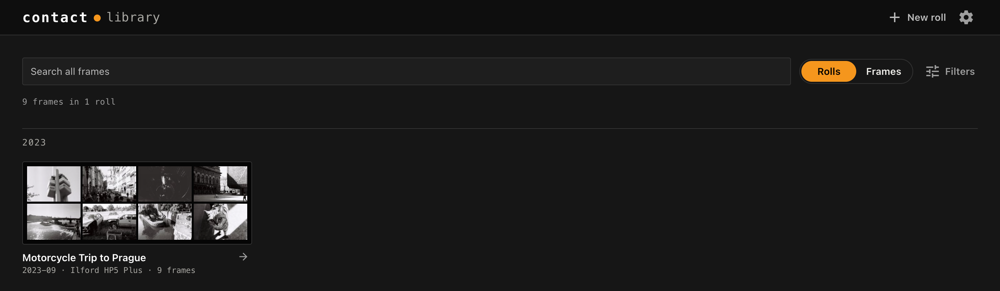
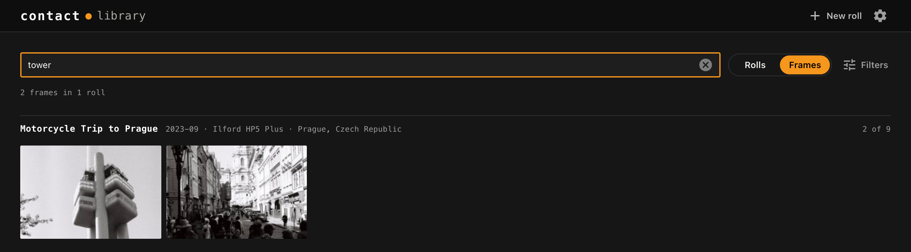
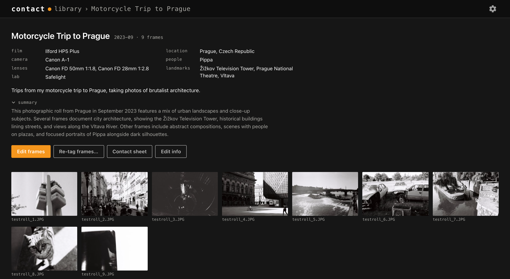
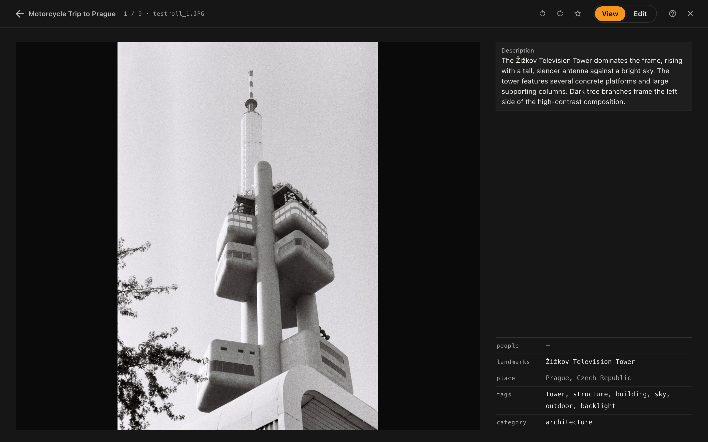
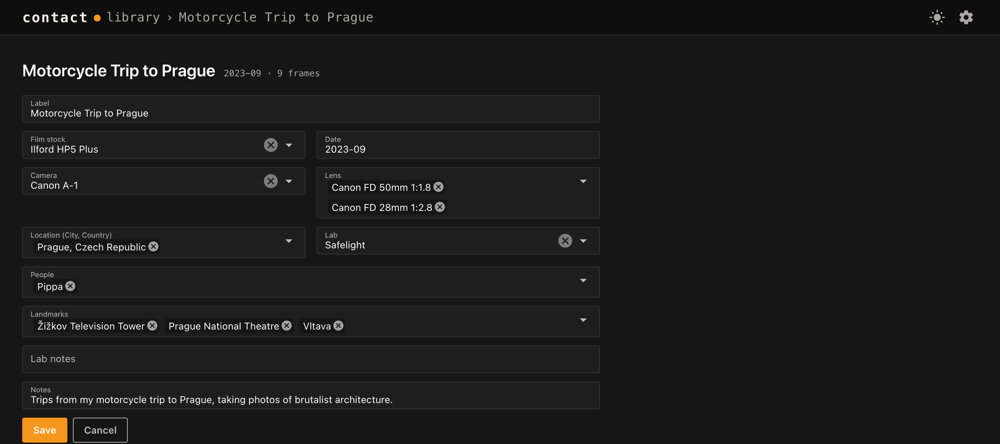
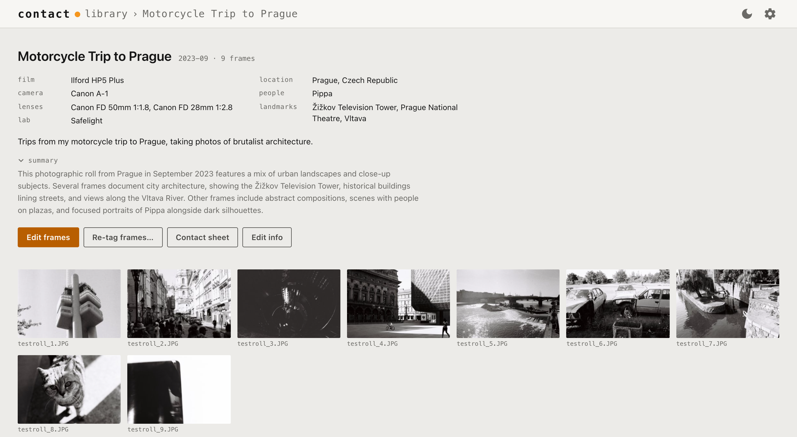

# contact


contact keeps an archive of analog film scans. A vision model running on your own computer describes and tags frames. You can quickly add people, landmarks and places by hand, and everything is written next to the scans: XMP sidecars that Lightroom, darktable and Finder read, and an HTML contact sheet per roll ([see one](https://moltaire.github.io/contact)).

- **A library of all your rolls.** Browse them as little contact sheets, or search every frame at once by what is in it, who, where, film or date.
- **A frame viewer.** Step through frames, correct descriptions, add people, landmarks and places, or refine LLM descriptions with a prompt.
- **Local and plain.** Ollama runs the model, nothing leaves your machine, and all metadata lives in ordinary files next to the scans.

---

## Install

You need Python 3.10+, [uv](https://docs.astral.sh/uv/) and [Ollama](https://ollama.com) with a vision model:

```bash
brew install ollama
ollama pull gemma4:e4b     # about 10 GB, runs fine with 16 GB of RAM
```

Then install contact:

```bash
uv tool install .
```

This gives you `contact-ui` (the app) and `contact` (the command line). contact starts Ollama itself when it isn't running.

### As a Mac app

```bash
contact-ui --install-app
```

This puts `contact.app` in `~/Applications`, so you can start contact from Spotlight, Launchpad or the Dock. It opens contact in your browser, or just switches to it if it's already running. contact keeps running in the background (tagging goes on with the tab closed) until you quit it in Settings.

The app starts the installed `contact-ui`, so updating contact with `uv tool install --reinstall .` updates the app too.

---

## Using contact

Start it with the app or with `contact-ui`. It opens in your browser. `?` lists shortcuts, the sun/moon switches between dark and light, the gear icon opens Settings.

### Adding a new roll

1. **New roll** (top right) opens a folder of fresh scans.
2. Fill in the roll's form: label, film, camera, lenses, date, location (`City, Country`), people, landmarks, lab and notes. Earlier entries are suggested as you type.
3. **Tag N new frames.** Tagging runs in the background, and frames fill in as they finish.
4. **Edit frames** to go through the results.
5. **Rename to …** gives the folder the standard `date_label` name, and **Move into library** moves it in with your other rolls. The contact sheet is already in the folder.

### The library



The **library** is the home page. Point it once at the folder that holds all your roll folders. Each roll shows as a small contact sheet, grouped by year. Click a roll to see its frames, or the arrow icon to open the roll's page.



**Search** looks through descriptions, tags, people, landmarks and places, and each roll's film, camera, lens and date. Quotes keep words together, and a prefix limits a word to one field: `person:ines`, `place:athens`, `film:hp5`, `tag:tower`, `date:2024`, `is:starred`. **Filters** lists the people, places and film stocks in the library. The view switch, or `V`, shows the results as **Rolls** or as **Frames**.

### A roll



A roll's page shows its facts, your notes, the generated summary and every frame.

- **Edit info** opens the roll's form.
- **Re-tag frames…** runs frames through the model again: click the ones you want (Shift-click for a range), then **Re-tag N frames**.
- **Contact sheet** opens the roll's `index.html`.

### A frame



Click any frame to see it large. ← → step through the frames you were looking at, across rolls when they come from a search, and Esc goes back.

- `S` marks a favourite.
- `[` `]` turn a sideways scan without touching the image data.
- `R` opens the frame's roll.
- `E` switches between **View** and **Edit**.

**Edit** adds the roll's filmstrip and an entry line under the description. Everything is saved as you go.

- **The entry line has five modes:** fact, tags, people, landmarks and place (`F`, `T`, `P`, `L`, `W`). Return opens it, Tab switches the mode while it's empty, Return applies.
- **A fact** is something the model can't know ("this is the Parthenon in Athens"). The model rewrites the description, tags and category with it, and you can undo.
- **Names** go in several at a time, separated by commas, and Tab completes a known one. The roll's people, landmarks and places appear under the line to click.
- **Removing:** click an entry in the list, or press Backspace on an empty line.
- **Several frames at once:** ⌘-click or Shift-click in the filmstrip, Shift-← →, or `A` for all. Whatever you enter applies to all of them.

<p>
  
  
</p>

**Settings** chooses the vision and text model and tidies the remembered options (places, people, landmarks, lenses, cameras, film stocks and labs). It's also where you quit contact.

---

## Command line

The same tagging without the app, for one roll or many:

```bash
contact --init ~/scans/tuscany/       # describe the roll in the terminal, then tag it
contact ~/scans/tuscany/              # tag what isn't tagged yet
contact ~/scans/2024/                 # a parent folder: every roll in it
```

| Flag | Description |
|---|---|
| `--init` | Describe the roll first |
| `--model MODEL` | Vision model (default: the best installed one) |
| `--text-model MODEL` | Model for the roll summary (default: the vision model) |
| `--force` | Re-tag frames that already have a sidecar |
| `--dry-run` | Show what would be written, write nothing |
| `--verbose` | Print the model's full answer per frame |
| `--no-rename-folder` | Keep the folder's name |

`contact-ui` takes `--folder DIR` to open a roll straight away, `--library DIR` to show another folder of rolls for one run, and `--light` to start in the light theme.

---

## What's written to disk

Everything sits next to the scans, so the folder is the archive:

- **`roll.yaml`**: the roll's facts and its summary.
- **One XMP sidecar per frame**: description, tags, category, people, landmarks, place and favourite, plus the roll's film, camera and lens.
- **`index.html`**: a contact sheet that looks like the roll's page, with search, favourites and a lightbox. Share the folder and the sheet goes with it.


Remembered options and settings live in `~/.config/contact/`.

## How tagging works

Each frame goes to the vision model once. It answers with a short description of what is visible, a few generic tags and one category. It doesn't guess who or where: names, landmarks and places are yours to add. When you give it a fact, it rewrites that frame. Once a roll is tagged, the model writes a short summary of the whole roll.

## Try it

A tagged sample roll is in `docs/example/sample-roll/` ([live contact sheet](https://moltaire.github.io/contact)). Open it as a one-roll library; browsing and editing works without Ollama:

```bash
contact-ui --library docs/example/
```

## Limitations

A small local model keeps your photos private and costs nothing, but it gets things wrong now and then. That's what the frame viewer is for. With plenty of memory you can choose a bigger model in Settings.
